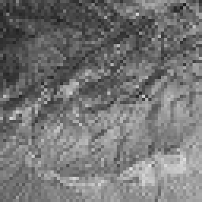
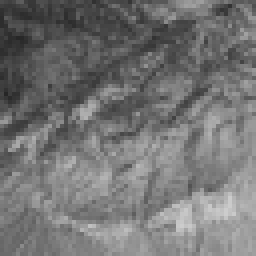

# Prmd modes

A `.prmd` file always stores the coarsest level as pixels. The **mode** (`--mode`, `EncodeOptions::transform`) decides two things:

1. **What a coarser level is:** how level L+1 is computed from level L. This sets what your crops at L ≥ 1 look like.
2. **What is stored for each finer level:** the data the decoder adds to level L+1 to get back level L.

| mode | level L+1 is | stored for each finer level | samples stored | lossy |
|---|---|---|---|---|
| [`haar`](#haar-default) (default) | exact integer 2×2 mean | 3 Haar detail bands | 1.0× level 0 | yes, no per-pixel bound |
| [`cdf53`](#cdf53) | 5/3 wavelet lowpass (as in JPEG2000) | 3 wavelet detail bands | 1.0× | yes, no per-pixel bound |
| [`laplacian`](#laplacian) | `box` or `gauss` downsample (`--down`) | residual vs. upsampled level L+1 | ~1.33× | yes, every level within ±Q/2 |
| [`naive`](#naive) | `box` or `gauss` downsample (`--down`) | every level as plain pixels | ~1.33× | no |

**Which to pick:**
- `haar` for small files with the fastest crops.
- `cdf53` for the smallest lossless files when you want sharper, JPEG2000-like coarse levels.
- `laplacian` when lossy files must stay within a guaranteed per-pixel error, or when coarse levels should be Gaussian-smoothed.
- `naive` only as the baseline.

All numbers below come from the gray 4096² benchmark in [benchmarks.md](benchmarks.md) (5 levels, zstd at the default level 1, lossless unless noted).

## Options

These apply to every mode unless the matrix below says otherwise. Each CLI option has a matching `prmd::EncodeOptions` field.

| CLI option | `EncodeOptions` field | values | default | what it does |
|---|---|---|---|---|
| `--mode` | `transform` | `haar`, `cdf53`, `laplacian`, `naive` | `haar` | this document |
| `--levels` | `levels` | 1–16 | 5 | number of levels N; level L is `ceil(W/2^L) × ceil(H/2^L)` |
| `--color` | `color` | `gray`, `rgb` | `gray` | stored format; the input is converted if it differs |
| `--down` | `downsampler` | `box`, `gauss` | `box` | the downsampler, for `laplacian` and `naive` only |
| `--quant` | `quant` | 0–4096 | 0 | 0 = lossless; Q > 0 = quantizer step, in 8-bit pixel values (0–255) (see each mode) |
| `--tile` | `tile` | multiple of `cblk`, ≤ 32768 | 256 | tile size: the unit blocks are grouped by on disk and counted by in stats |
| `--cblk` | `cblk` | even, 16–4096 | 128 | code-block size: the unit of decoding, I/O and caching |
| `--entropy` | `entropy` | `zstd`, `range`, `raw` | `zstd` | coder for each block's numbers (below) |
| `--entropy-level` | `entropy_level` | zstd: 1–22; others: 0 | 0 (= zstd 1) | zstd compression effort; decode speed is the same at every level. Level 19 encodes 13–36× slower on one thread, 6–21× with the default threads (mode-dependent): it makes gray lossless files no smaller, but RGB files 2.7–4.1% and lossy files 3–12% smaller |
| `--no-med` | `med = false` | flag | MED on | base blocks store pixel values without MED prediction: faster to decode, larger file |
| `--no-ycocg` | `ycocg = false` | flag | YCoCg-R on | RGB stores R, G, B without YCoCg-R; ignored for gray |
| `--threads` | `threads` | 0, 1, 2, … (≤ 256 used) | 0 | encoder threads: 0 = automatic (chosen per image from its size and the cost of the mode and coder, up to one per hardware thread; small images encode serially), 1 = serial, N = at most N. Changes only the encode time: the file is byte-identical for every value ([design.md §1.4](design.md)) |

**Which options apply to which mode:**

| | `haar` | `cdf53` | `laplacian` | `naive` |
|---|:-:|:-:|:-:|:-:|
| `--levels`, `--color`, `--tile`, `--cblk`, `--entropy`, `--entropy-level`, `--threads` | ✓ | ✓ | ✓ | ✓ |
| `--no-med` | coarsest level | coarsest level | coarsest level | every level |
| `--no-ycocg` (RGB) | ✓ | ✓ | ✓ | ✓ |
| `--down` | ignored | ignored | ✓ | ✓ |
| `--quant` > 0 | open loop | open loop | closed loop | rejected |

**Entropy coders** (gray, `haar`):
- `zstd`: the default. 11.58 MiB, 0.59 ms per 256² crop.
- `range`: a context-adaptive range coder. Files are 4–5% smaller (11.13 MiB), but decode is about 12× slower (7.4 ms).
- `raw`: uncompressed (32 MiB). Only useful for measuring transform cost.

**Color.** With `rgb`, each channel gets the gray mode's filters independently. The stored values then go through the reversible YCoCg-R transform, so RGB stays bit-exact when lossless.

**Decoder.** The decoder has one option, `DecoderOptions::cache_bytes`: an LRU cache of decoded blocks, off by default. It works the same in every mode.

## The running example

To keep the numbers readable, every mode below is shown on one row of 8 pixels: a gentle ramp, then a sharp edge.

```
level 0:  [10, 12, 14, 16, 60, 62, 64, 66]
```

The real filters are 2-D, but they're separable (rows, then columns), so one row shows everything that matters. Every number below was checked against the codec. I encoded an 8×2 image made of this row twice (so the vertical pass changes nothing) with `--levels 2` and decoded level 1 with `prmd decode`.

## `haar` (default)

**Name.** After Alfréd Haar, who described this simplest of all wavelets in 1910: split each pair of values into their average and their difference. The integer version used here is known as the *S-transform*.

**Level L+1** is the exact integer 2×2 mean. For a 2×2 block `a b / c d`:

```
l0 = ⌊(a+b)/2⌋   h0 = a − b          (row 1)
l1 = ⌊(c+d)/2⌋   h1 = c − d          (row 2)
LL = ⌊(l0+l1)/2⌋                      → the level L+1 pixel
LH = l0 − l1    HL = ⌊(h0+h1)/2⌋    HH = h0 − h1   → stored
```

The rounding is "floor of floors", so a pixel can be 1 lower than `⌊(a+b+c+d)/4⌋`.

**Stored per finer level:** the three detail bands LH (vertical difference), HL (horizontal difference) and HH (diagonal), each at half resolution. That's 3 numbers per 2×2 block: the 4 pixels become 1 coarse pixel plus 3 details, so nothing is stored twice. The decoder inverts each pair exactly with `x = L + ⌊(H+1)/2⌋`, `y = x − H`.

**Example.** The 2-D block `10 12 / 11 13` gives LL = 11, LH = −1, HL = −2, HH = 0. On the running row:

```
level 1 (L):  [11, 15, 61, 65]
stored  (H):  [−2, −2, −2, −2]        ← a − b for each pair
```

The ramp and the edge both produce tiny, identical details, because the edge falls between pairs. Small, repetitive numbers are what compresses well.

**Lossy** (`--quant Q`): open loop.
- Steps: LH and HL use step Q, and HH uses 2Q.
- Each coefficient is rounded to the nearest multiple of its step, `idx = sign(v)·⌊(|v|+step/2)/step⌋`.
- The coarsest level stays exact.

Errors made at level L+1 carry down into level L, so there is no per-pixel bound, only an average quality (PSNR). With Q = 4 on the example, H = −2 rounds to −4 (index −1):

```
level 0 decodes to  [9, 13, 13, 17, 59, 63, 63, 67]     (exact: [10, 12, 14, 16, 60, 62, 64, 66])
```

**Measured:**
- Lossless: 11.58 MiB (−23.0% vs `naive`), 0.56 ms per 256² crop at L0.
- Q = 4: 3.66 bits/px, 38.6 dB at L0, max error 12 (in 8-bit pixel values, 0–255).
- Coarse levels alias a little, like any 2×2 mean.

```sh
build/prmd encode in.jpg out.prmd                       # haar, lossless
build/prmd encode in.jpg out.prmd --quant 4             # haar, lossy
```

## `cdf53`

**Name.** *CDF* stands for Cohen–Daubechies–Feauveau, who described this family of biorthogonal wavelets in 1992. *5/3* gives the filter lengths: the lowpass filter has 5 taps (−1/8, 1/4, 3/4, 1/4, −1/8) and the highpass filter has 3. The same filter is also called *LeGall 5/3*.

**Level L+1** is the lowpass of the reversible 5/3 wavelet, the same lossless filter JPEG2000 uses. It runs on rows, then columns, with symmetric extension at the borders:

```
d[n] = x[2n+1] − ⌊(x[2n] + x[2n+2]) / 2⌋        detail: odd pixel minus its prediction from its neighbours
s[n] = x[2n]   + ⌊(d[n−1] + d[n] + 2) / 4⌋      level L+1 pixel: even pixel, corrected by nearby details
```

In 2-D this gives LL (the level L+1 pixel) and the bands LH, HL and HH, as in `haar`. The levels are computed on unclamped integers, and each returned level is clamped to 0–255.

**Stored per finer level:** 3 detail bands, 1.0× samples, same as `haar`. Each detail depends on its neighbours, so a crop needs a margin of 1 coefficient per side at each level. That's slightly more blocks than `haar`.

**Example:**

```
level 1 (L):  [10, 9, 55, 65]
stored  (d):  [0, −21, 0, 2]
```

- On the ramp the prediction is exact, so the detail is 0. That's why `cdf53` compresses smooth areas best.
- At the edge, the detail is large (−21) and the coarse level dips to 9 just before the edge. That dip is the 5/3 filter's negative side taps: it makes levels look sharper, with slight ringing at strong edges.

**Lossy:** the same rules as `haar`: open loop, LH/HL step Q, HH step 2Q, no per-pixel bound.

**Measured:**
- Lossless: 11.18 MiB (−25.7% vs `naive`), the smallest `.prmd` file. 0.66 ms per 256² crop at L0.
- Q = 4: 3.53 bits/px, 41.9 dB, max error 11 (pixel values).
- Its levels differ from the 2×2 mean by 24–28 dB PSNR, mostly a half-pixel shift.

```sh
build/prmd encode in.jpg out.prmd --mode cdf53
```

## `laplacian`

**Name.** After the *Laplacian pyramid* (Burt & Adelson, 1983), which stores each level as the difference between that level and the coarser level scaled back up. Blurring and subtracting is a difference of Gaussians, which closely approximates the Laplacian operator ∇² (a second derivative) applied to a smoothed image. So each stored residual looks like a Laplacian-filtered image: near zero where the image is flat or slopes evenly, and large only at edges and texture. The running example shows this below. The name describes this structure, whichever downsampler is used.

**Level L+1** is any downsampler, chosen with `--down`:
- `box` (default): rounded 2×2 mean `(a+b+c+d+2) >> 2`.
- `gauss`: `[1 4 6 4 1]/16` in both directions, mirrored at borders, then every second pixel. Smoother, with almost no aliasing.

`box` is named after the box filter, whose weights are all equal, so its kernel is a flat "box". `gauss` is named after the Gaussian: the binomial weights `1 4 6 4 1` approximate a Gaussian bell curve. This is exactly the kernel Burt & Adelson used, with their parameter a = 0.375 (= 6/16).

**Stored per finer level:** the residual, `level L − U(level L+1)`. U is a fixed integer 2× upsampler that matches the downsampler's alignment:
- `box`: `U(2n) = ⌊(3c[n] + c[n−1] + 2)/4⌋`, `U(2n+1) = ⌊(3c[n] + c[n+1] + 2)/4⌋`
- `gauss`: `U(2n) = c[n]`, `U(2n+1) = ⌊(c[n] + c[n+1] + 1)/2⌋`

A residual is stored for every pixel of every finer level, so the file holds ~1.33× the samples. The decoder never runs the downsampler: it only needs U and the stored residual.

**Example:**

```
--down box:    level 1 [11, 15, 61, 65]   U(level 1) [11, 12, 14, 27, 50, 62, 64, 65]
               stored residual            [−1, 0, 0, −11, 10, 0, 0, 1]

--down gauss:  level 1 [12, 17, 47, 64]   U(level 1) [12, 15, 17, 32, 47, 56, 64, 64]
               stored residual            [−2, −3, −3, −16, 13, 6, 0, 2]
```

Both store 8 numbers, where `haar` and `cdf53` store 4, and that's why the files are larger. The `gauss` level is visibly smoother: 47 sits halfway up the edge.

**Lossy:** closed loop, the main reason to use this mode. Starting from the top, the encoder rebuilds each level exactly as the decoder will and takes the next residual against that. Errors never carry down, so on gray **every level is within ±Q/2 of the lossless pyramid**, and the tests check this. Residuals use step Q. For RGB, quantization happens on Y/Co/Cg, so the ±Q/2 bound doesn't apply per RGB channel.

**Measured:**
- `gauss`, lossless: 14.29 MiB (−5.0% vs `naive`), 0.75 ms per 256² crop at L0.
- `gauss`, Q = 4: 4.72 bits/px, 46.4 dB, **max error 2** (pixel values).
- `box`, lossless: 14.43 MiB.
- RGB, lossless: 32.38 MiB (`gauss`) and 31.96 MiB (`box`), 3.6–5.0% *larger* than `naive` (30.84 MiB); see [benchmarks.md](benchmarks.md#rgb). Use `haar` or `cdf53` for RGB unless you need the closed-loop lossy bound.

```sh
build/prmd encode in.jpg out.prmd --mode laplacian --down gauss
build/prmd encode in.jpg out.prmd --mode laplacian --down gauss --quant 4   # every pixel within ±2 of lossless
```

## `naive`

**Name.** It is the straightforward, "naive" layout from the task: every level stored on its own, with no use of the fact that each level is made from the one below. The code calls it `Transform::Independent`.

The task's baseline. Every level is downsampled with `--down` (`box` or `gauss`, as in `laplacian`) and stored on its own as plain pixels, using the same block layout and entropy coder as the other modes. A crop reads only its own level, so it touches fewer blocks (8.9 against 17.5 for `haar` at L0). The file stores 1.33× the samples, though, so it's 30% larger than `haar`'s. Crops are about as fast as `haar`'s: fewer blocks, but each pixel block runs the MED predictor, which goes pixel by pixel. `--no-med` skips it: crops get about 1.5× faster (gray) and the file 23% larger ([benchmarks.md](benchmarks.md)).

**Example:** level 1 is `[11, 15, 61, 65]` with `box`, and the file stores the 8 pixels of level 0 plus the 4 of level 1.

**Lossy:** not supported. `--quant` > 0 is rejected.

**Measured:** 15.04 MiB, 0.57 ms per 256² crop at L0.

```sh
build/prmd encode in.jpg out.prmd --mode naive
```

## How the levels look

Here is the same 64×64 patch of level 3 for each definition, zoomed 4×. `naive` with `box` produces the same levels as `laplacian` with `box`.

| `haar` | `cdf53` | `laplacian` / `naive`, `box` | `laplacian` / `naive`, `gauss` |
|:-:|:-:|:-:|:-:|
|  |  |  |  |
| exact 2×2 mean | sharpest, slight ringing | ≈ `haar` (rounding differs by 1) | smoothest, least aliasing |

`prmdbench` writes the full 256² samples to `build/bench/samples/` (git-ignored; see the README).

**PSNR against the `haar` 2×2-mean pyramid** (higher means closer):

| definition | L1 | L2 | L3 | L4 |
|---|---:|---:|---:|---:|
| `haar` | exact | exact | exact | exact |
| `box` (`laplacian`, `naive`) | 50.2 dB | 45.6 dB | 42.4 dB | 40.0 dB |
| `gauss` | 30.1 dB | 29.8 dB | 29.6 dB | 29.5 dB |
| `cdf53` | 27.6 dB | 25.5 dB | 24.8 dB | 24.5 dB |

## Modes and PSNR

### What PSNR is

PSNR compares two images: one picture against another, or a level against a reference level. Its unit is the decibel (dB).

- A high PSNR means the two images are almost the same. A low PSNR means they are different.
- If the two images are identical, the PSNR is infinite (∞).
- Each 6 dB increase halves the average error.

This table gives the average (RMS) error for some PSNR values. The error unit is one 8-bit pixel value, on the scale 0–255.

| PSNR | Average error | What you see |
|---:|---:|---|
| 50 dB | 0.8 | No visible difference |
| 45 dB | 1.4 | No visible difference |
| 40 dB | 2.6 | Very small differences |
| 35 dB | 4.5 | Small differences on edges and texture |
| 30 dB | 8.1 | Clear differences |
| 25 dB | 14 | A different image |

All values below come from the gray 4096² benchmark, with 5 levels ([benchmarks.md](benchmarks.md)).

### Lossless files (the default)

**Rule:** In lossless mode, each level decodes bit for bit. The PSNR of each level against its stored value is ∞. This is true for all modes.

The modes do not calculate the coarse levels in the same way. The PSNR below compares the coarse levels of each mode with the `haar` levels, which are the exact 2×2 mean.

**Important:** Here, PSNR measures difference only. It does not measure quality. A low value does not mean a bad image.

| Mode | L1 | L2 | L3 | L4 | Meaning |
|---|---:|---:|---:|---:|---|
| `haar` | ∞ | ∞ | ∞ | ∞ | This is the reference: the 2×2 mean. |
| `naive` or `laplacian`, with `--down box` | 50.2 dB | 45.6 dB | 42.4 dB | 40.0 dB | Almost the same as `haar`. Only the rounding is different, and the difference increases at each level. |
| `laplacian`, with `--down gauss` | 30.1 dB | 29.8 dB | 29.6 dB | 29.5 dB | A smoother image. It has less aliasing. |
| `cdf53` | 27.6 dB | 25.5 dB | 24.8 dB | 24.5 dB | A sharper image, as in JPEG2000. It also has a half-pixel shift. |

`naive` with `--down gauss` has the same levels as `laplacian` with `--down gauss`, because the two modes use the same filter.

**Use this table to select a mode:**
- If your image matcher needs the exact 2×2 mean, use `haar`.
- If your image matcher needs less aliasing, use `cdf53` or `gauss`.

### Lossy files (`--quant Q`)

With `--quant Q`, the encoder removes small details to make the file smaller. Q is the quantizer step. A large Q gives a small file and a low PSNR.

In this part, PSNR compares the decoded image with the source image. Here, a high PSNR means better quality.

#### `haar`

| Q | Size (bits/px) | PSNR at L0 | PSNR at L2 | Maximum error |
|---:|---:|---:|---:|---:|
| 2 | 4.56 | 40.3 dB | 45.1 dB | 8 |
| 4 | 3.66 | 38.6 dB | 42.7 dB | 12 |
| 8 | 2.90 | 35.1 dB | 38.5 dB | 21 |

- `haar` gives the lowest PSNR of the three lossy modes.
- The error increases from the coarse levels to L0, because the encoder does not correct errors between levels. This is "open loop". Thus L2 is 3–5 dB better than L0.
- `haar` does not have a maximum-error limit.

#### `cdf53`

| Q | Size (bits/px) | PSNR at L0 | PSNR at L2 | Maximum error |
|---:|---:|---:|---:|---:|
| 2 | 4.43 | 44.5 dB | 47.0 dB | 8 |
| 4 | 3.53 | 41.9 dB | 43.6 dB | 11 |
| 8 | 2.77 | 37.1 dB | 38.6 dB | 22 |

- `cdf53` is the best lossy `.prmd` mode. At each Q, it is 2–4 dB better than `haar`, and its file is slightly smaller.
- It is also open loop: L2 is 1.5–2.5 dB better than L0.
- `cdf53` does not have a maximum-error limit.

#### `laplacian`, with `--down gauss`

| Q | Size (bits/px) | PSNR at L0 | PSNR at L2 | Maximum error |
|---:|---:|---:|---:|---:|
| 2 | 5.90 | 51.2 dB | 51.1 dB | 1 |
| 4 | 4.72 | 46.4 dB | 46.4 dB | 2 |
| 8 | 3.71 | 40.8 dB | 40.8 dB | 4 |

- `laplacian` gives the highest PSNR at each Q.
- It is "closed loop": the encoder corrects the errors at each level. Thus all levels have the same PSNR.
- **This is the only mode with a guaranteed limit.** The error at each pixel is never more than Q/2.
- Its files are approximately one third larger than `cdf53` files at the same Q.
- For the same file size, `cdf53` gives a higher PSNR. For example, at 3.71 bits/px `laplacian` gives 40.8 dB, while at 3.53 bits/px `cdf53` gives 41.9 dB.
- Thus, use `laplacian` when you need the error limit. Do not use it for the smallest file.

#### `naive`

`naive` is lossless only. The encoder does not accept `--quant` with `naive`.

#### JPEG2000 (for comparison)

| Size (bits/px) | 3.94 | 3.14 | 2.35 | 1.54 |
|---|---:|---:|---:|---:|
| PSNR at L0 | 49.1 dB | 44.7 dB | 39.8 dB | 34.8 dB |
| Maximum error | 7 | 10 | 22 | 56 |

- JPEG2000 gives approximately 3 dB more than `cdf53` for the same file size.
- For the same PSNR, it needs approximately 25% fewer bits.
- But its crops decode 15–27 times more slowly than `.prmd` crops.

### RGB images

- Lossless RGB is also bit for bit (∞ dB).
- The encoder quantizes the Y, Co and Cg channels, not the R, G and B channels. Thus the `laplacian` limit of Q/2 does not apply to each RGB channel. In the benchmark, the maximum RGB error is equal to Q.
- On RGB, the JPEG2000 advantage is larger. At approximately 40 dB, JPEG2000 needs 3.2 bits/px and `cdf53` needs 6.7 bits/px.

### Summary

| You need | Use this mode | Why (PSNR) |
|---|---|---|
| Exact pixels and the 2×2 mean at each level | `haar`, lossless | ∞ dB at each level, and the levels are the reference |
| Coarse levels with less aliasing | `cdf53` or `gauss`, lossless | ∞ dB at each level, but a different filter (24–30 dB from `haar`) |
| The smallest lossy file | `cdf53` with `--quant` | 2–4 dB better than `haar` for a slightly smaller file |
| A guaranteed maximum error | `laplacian` with `--quant` | Error never more than Q/2, with the same PSNR at all levels |
| The best quality for each bit, when crop speed is not important | JPEG2000 | Approximately 3 dB better than `cdf53`, but 15–27 times slower crops |

## Not a mode: JPEG2000

`--codec j2k` writes a JPEG2000 file with OpenJPEG instead of `.prmd`, for comparison. Its levels are 5/3 wavelet levels, like `cdf53`'s.
- `--j2k-tile`: tile size, default 256.
- `--j2k-lossy-psnr DB`: switches to the lossy 9/7 wavelet and aims for that PSNR.

`--levels`, `--color` and `--threads` work as for `.prmd` (J2K uses at most one thread per 4 code-blocks of a tile, so 4 with 256² tiles), and the other options are ignored. JPEG2000 makes 6.4% smaller lossless files than `haar` (10.84 MiB), but crops are 15–27× slower, and coarse-level crops read most of the file. See [writeup.md](writeup.md).
